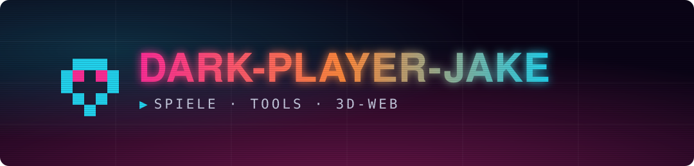
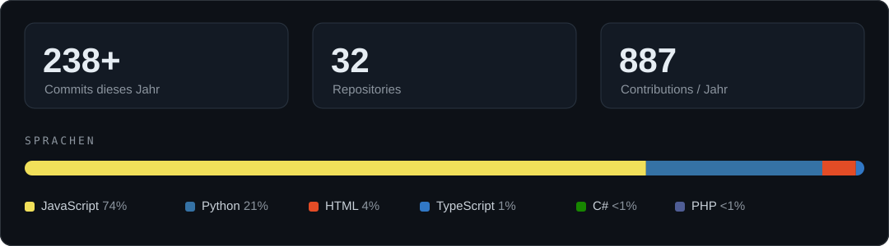
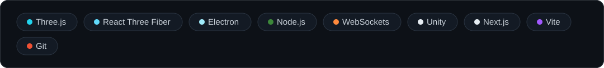

  

  
  
  

## Hi, ich bin Jakob

Ich baue in meiner Freizeit Software von Grund auf: Browser- und Unity-Games, Desktop-Tools mit Electron und interaktive 3D-Websites. Mein Anspruch ist, dass am Ende etwas Fertiges steht und kein ewiger Prototyp.

Die meisten meiner Projekte sind privat. Hier siehst du deshalb vor allem, **woran** und **womit** ich arbeite.

---

### Auf einen Blick

  

### Woran ich arbeite

| Bereich | Was ich baue | Typischer Stack |
| --- | --- | --- |
| **Spiele** | Browserspiele, Multiplayer im LAN, 3D-Simulationen, Roblox-Experiences | Three.js · WebSockets · Unity · Luau |
| **Desktop-Tools** | Local-first-Werkzeuge, Automatisierung, Helfer für den Alltag am Rechner | Electron · React · Node.js |
| **3D-Web** | Interaktive Websites mit Echtzeit-3D, Konfiguratoren, Scroll-Erlebnisse | Next.js · React Three Fiber · Blender |
| **KI & Automatisierung** | Lokale Assistenten, Sprachsteuerung und Agenten-Workflows | Python · Ollama · Claude Code |

### Wie ich arbeite

- **Fertig statt halb fertig:** Abnahme am echten Gerät, bevor etwas als erledigt gilt.
- **Local-first:** Daten und Modelle bleiben auf dem Rechner, wo es sinnvoll ist.
- **Getestet:** Automatische Tests und echte Sichtprüfung gehören zum Bauen dazu.

### Tech-Stack

  

